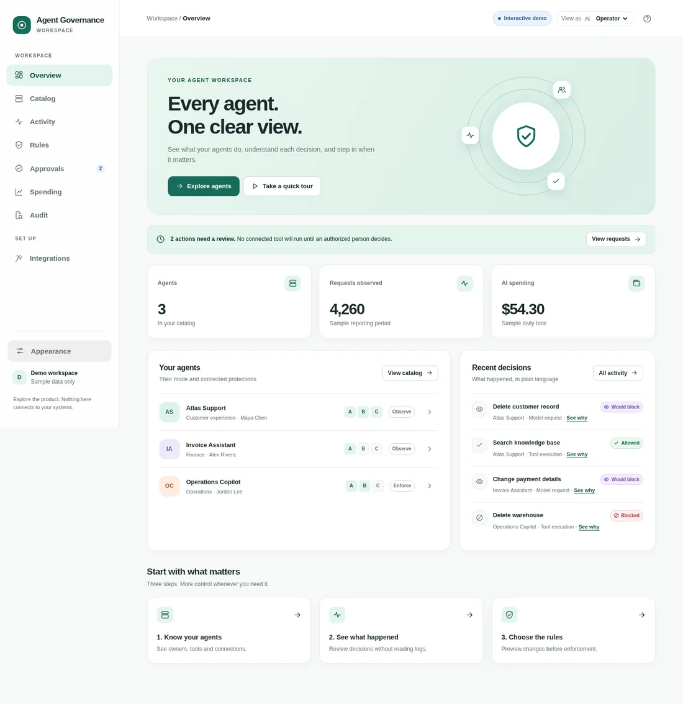

# Agent Governance · interactive prototype

A navigable, minimal, responsive **visual prototype**, deliberately separated from the AWS-style documentation console. It demonstrates how someone new to AI governance might explore agents, decisions, connections, approvals and audit trails—without technical overload.



> **Visual simulation only.** Every agent, request, cost, model, identity, approval, trace and key is synthetic. This is not a production console, not an authentication service, and does not call or enforce AWS/Cedar/MCP/OIDC. Backend behavior is a proposal, not something this frontend validates.

## Try it

**No installation:** open `index.html` on a static web host. For local development, use Node 20+:

```bash
npm run dev
# open http://127.0.0.1:4173
```

```bash
npm run check  # JavaScript syntax + 22+ domain / UI tests
npm run build  # creates self-contained static dist/
```

No npm packages, external fonts, remote telemetry, tracking scripts, CDNs or external runtime dependencies. The app runs entirely in the browser. Interaction state is saved in that browser's local storage and can be reset from **Appearance → Reset the demo**.

## First-time walkthrough

1. **Overview**: see how many agents exist, which actions need attention and why recent decisions were made.
2. **Catalog**: inspect an agent; test a model request and then a tool execution.
3. **Integrations**: choose the agent and compare A (monitor model traffic), B (control actual MCP tool execution), C (identity attribution). Turn B on in the **simulation** and return to the agent.
4. **Rules**: preview the consequences of enforcing policies before confirming.
5. **Approvals**: switch the role preview from Operator to Approver; approve/reject with a separate reviewer. Auditor stays read-only.
6. **Activity → Audit**: trace a result back to its cause, rule version and sample evidence indicator. A missing record is not shown as valid evidence.
7. **Appearance**: switch among Forest, Violet, Ocean, and light/dark. These use semantic tokens, not colors repeated in every component.

Other flows: search the catalog and activity, filter event types, pause a simulated feed, set a daily budget, add a demo-only agent, inspect a hidden-on-close sample key and reset the whole simulation. Use the quick tour on the home screen if you are new.

## Information architecture

| Destination | First question | What stays out of the initial view |
| --- | --- | --- |
| Overview | What matters now? | JSON, Cedar, storage configuration |
| Catalog | What agents, tools, and models do I have? | Account wiring and classified tool schema |
| Agent details | What does this agent do and what is missing? | Raw call payload |
| Activity | What happened recently? | Long logs |
| Rules | What would change if I enforced rules? | Cedar syntax and parameter-level editor |
| Approvals | What needs a person to decide? | Unrelated metrics |
| Spending | What costs money and where is its limit? | Detailed billing integrations |
| Audit | Why did an action happen? | Complex forensic query language |
| Integrations | How do I extend what can be governed? | OIDC/MCP configuration code until requested |

The product navigation follows the user's task, **not** implementation slices S0–S6. The source documentation retains the slice-by-slice explanation separately.

## Governance boundaries that must not be lost

- **A (inference)** is always the first integration. It can authenticate a model request, observe declared tool calls, apply inference-path rules and show agent costs. Observing a tool call **does not** prove or govern that tool's later execution.
- **B (MCP tools)** is optional. It can govern real tool executions **only for tools routed through B**. Tools that stay local or bypass the gateway are explicitly marked not covered.
- **C (user identity)** is optional. It attributes allowed requests to verified end-users in the intended backend. The demo's role switcher is just a view preview, not OIDC or actual identity proof.
- **Observe** displays would-block outcomes without enforcing applicable policy denials. The intended backend can still actively enforce separately configured authentication, guardrails, limits and suspension in this mode.
- **Enforce** applies configured policy to **requests in the relevant channel**; it must not turn an unconnected local tool into a false “blocked” result.
- **Paused/Suspended** cuts gateway calls, but cannot assert all tool activity outside the gateway stops.
- **Approvals** for critical tool execution depend on B and an authorized, distinct reviewer in the intended architecture.
- **Audit** uses fictional sample records. A future backend's immutable evidence must be verified independently; no frontend UI can prove Object Lock or retention.

## Design system

The only source for palettes, semantic colors, typography, spacing and radii is [`src/styles/tokens.css`](src/styles/tokens.css). `src/styles/app.css` uses the `var(--token)` references. To add a palette, create `:root[data-theme='new-name']` overriding `--accent`, `--accent-hover`, `--accent-soft`, `--accent-ink`, `--brand-art`, `--hero-top`, and `--hero-bottom`; then add it to the Appearance control in [`src/views.js`](src/views.js) and validate contrast. Status colors (`success`, `danger`, `warning`, `preview`, `info`, `neutral`) represent meaning and **must not** change to match brand preference. Tokens cover light and dark; reduced-motion and focus-visible rules are included.

Components: `btn`, status pill, `pageHeading`, card, agent row, drawer, modal and tour form a lightweight no-library visual system. Dynamic text is HTML-escaped; demo state revalidates on load. Form labels, landmark headings, live announcer, focus trap and Escape behavior support keyboard use. **Automated and human screen-reader review remain follow-up requirements**; do not claim WCAG AA certification based only on screenshots and a test suite.

## Repository map

```text
index.html                   Accessible SPA shell
src/styles/tokens.css        Theme and semantic variables
src/styles/app.css           Responsive components/layout
src/data.js                  Synthetic fixtures, copy and guided tour
src/domain.js                Pure simulation, guards, state and status mapping
src/views.js                 Screen components, drawers and modals
src/app.js                   Browser events, routing, persistence, confirmations
scripts/serve.mjs            Local server without dependencies
scripts/build.mjs            Publishable dist/ generator
.github/workflows/           CI and GitHub Pages workflows
tests/                       Node domain and markup tests
docs/                        UX traceability and editorial decisions
```

## Publish this repository on GitHub Pages

This project is proposed through a pull request in [`enzo-loren/agent-ai-governance-ui`](https://github.com/enzo-loren/agent-ai-governance-ui). **A pull request is not itself a live deployment.** Review the UI and quality checks before merging.

1. Go to **Settings → Pages → Build and deployment** and choose **GitHub Actions**.
2. Review and merge the prototype pull request into `main` when ready. (Do not merge before review.)
3. [`.github/workflows/pages.yml`](.github/workflows/pages.yml) runs `npm run check && npm run build` and deploys the `dist/` directory after a push to `main`. The [quality workflow](.github/workflows/quality.yml) runs the same checks on the pull request.
4. Confirm the actual deployed address in the Actions run or the Pages settings before sharing it. For a normal public repository with default Pages settings, GitHub typically uses a project-site URL, but **the repository has not been verified live yet**.

The source used for this PR came from a verified offline ZIP and its Git bundle. The verbose editorial rationale was carried into the PR's individual commits. The ZIP-only `COMMIT_HISTORY.bundle` is not needed in this repository and is deliberately not committed; the GitHub commit history replaces it.

No backend, AWS credentials, stored secrets, external dependencies, or production auth flows are involved. This remains a visual and behavioral simulation.

## Evidence and UX references

The repository's governing source of truth remains `agentic-ai-governance-platform/insumo/requisitos.yaml`, particularly `CON-01…08`, `POL-01…04`, `REG-01…03`, `IDN`, `MCP`, `HITL`, `FIN`, and `EVD` sections. The presentation site and `assets/console-data.json` supplied the screen inventory; see [`docs/traceability.md`](docs/traceability.md).

Community standards considered: [Nielsen Norman Group, 10 Usability Heuristics](https://www.nngroup.com/articles/ten-usability-heuristics/), [NN/g, Progressive Disclosure](https://www.nngroup.com/articles/progressive-disclosure/), [Microsoft, Guidelines for Human-AI Interaction](https://www.microsoft.com/en-us/research/project/guidelines-for-human-ai-interaction/), [Google PAIR, People + AI Guidebook](https://pair.withgoogle.com/guidebook/), [W3C WCAG 2.2](https://www.w3.org/TR/WCAG22/). These are decision references, not a certificate of compliance.

All demo examples and names are fictional. This code is not meant to handle actual API keys, sensitive traces or user data.
